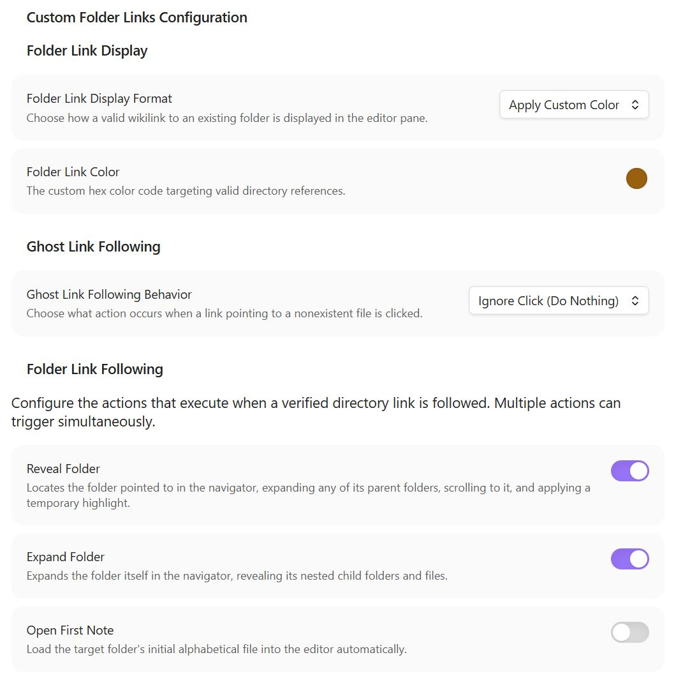

# Custom Folder Links for Obsidian
A lightweight plugin that adds support for folder linking via standard `[[Wikilinks]]` in Obsidian. Unlike similar addons, this one enables folder links **without** relying on hidden notes being created for each folder in the vault, nor does it require any special syntax inside of the wikilink for folders.

## Plugin Operation
### Plugin Behavior
Obsidian's core engine treats links to non-existent notes as "ghost links" and forces a brand-new markdown file to be created when those links are clicked. Because Obsidian has no system in-place to allow wikilinks to directories, any wikilink pointing to a directory will result in a new md file of that same name being created.

This plugin enhances how Obsidian handles wikilink following as well as wikilink display in the Live Editor pane. It does the former by intercepting link clicks, checking their destination, and optionally executing some alternative behavior. 

### Nice to Know
- This plugin can be safely enabled and disabled without modifying the contents of your vault in any way.
- This plugin retains no vault state between sessions.
- Existing wikilinks to folders that showed up in Obsidian as unresolved without this plugin will resolve properly after activating this plugin. 
- Name conflicts are handled by prioritizing default built-in link follow logic first -- in other words, this plugin only modifies the behavior of link clicks that would be considered unresolved without this plugin. 
- For the case where the wikilink is valid and points to an existing file, this plugin does nothing and just forwards the link click to Obsidian's native handler.
- For the case where there exists a directory and a file with identical names (e.g. when a folder has a file within it by the same name like some other plugins create automatically), this plugin leaves the existing link-click behavior in place. Upon deletion of the identically-named file, the wikilink will auto-update to point to the directory instead.

## Configuration Options



### Ghost Link following
Adds a configuration setting to disable the creation of new md files for links that point to nonexistent files.

### Folder Link Display
Adds a configuration setting to change how wikilinks to vault folders are displayed in the live editor pane. The default in-place behavior in Obsidian (because folder wikilinks aren't allowed) is to decorate those links as if they were unresolved file references. The options this plugins provides are:
- *No Modification (Default):* Keeps native Obsidian theme behavior unchanged.
- *Display as Valid File Link:* Dynamically strips the faded "ghost" formatting, making valid directory links visually appear as fully resolved files.
- *Apply Custom Color:* Strips the ghost-file fade and injects a custom color override with a RGB color picker.

### Folder Link Following
Adds logic to intercept wikilink clicks for which the target file doesn't exist, but a **folder with that name/path does**. Adds configuration settings to toggle what actions (if any) should be performed when following a valid folder link. Options can be toggled independently or in any combination and are:
- *Reveal Folder:* Locates the folder pointed to in the navigator sidebar, expanding any parent folders, scrolling to it, and applying a temporary highlight.
- *Expand Folder:* Expands the destination folder in the sidebar, revealing its nested child files and subdirectories.
- *Open First Note:* Scans the destination folder and opens the (alphanumerically) first markdown file into the active tab.

## Plugin Implementation Details
**Permissions:**
- This plugin makes no modifications to your vault in any way
- This plugin never accesses the contents of your notes. It operates purely using metadata, file names, css elements, and link text.
- This plugin does access the layout of your vault and the names of the folders and files within your vault.

**Performance:**
- Built on top of the Obsidian metadata cache to avoid any unnecessary scans or reads
- Doesn't perform any file reads or filesystem calls
- No idle footprint.
- Link Display altering is done via a codemirror extension.

## How To Use
1. Configure the plugin on the "Custom Folder Links" tab under the "Community Plugins" section of the Obsidian settings tab.
2. Wikilinks to folders should be written the same way wikilinks to files are e.g. ```[[Your Folder Name]]```
3. If the directory exists in your vault, the configured folder link display setting will auto-apply and clicks on the link will adhere to the configured folder link setting behavior.

## Installation
### From Community Plugins
1. Inside Obsidian, navigate to **Settings** > **Community Plugins** > **Browse**.
2. Search for **Custom Folder Links**.
3. Click **Install**, then **Enable**.

### Manual Installation
1. Download the latest `main.js` and `manifest.json` files from the [Releases](#) tab.
2. Go to your local vault directory and locate the hidden configurations folder: `.obsidian/plugins/`.
3. Create a new folder named `custom-folder-links` and move the downloaded files inside it.
4. Open Obsidian, head to **Settings** > **Community Plugins**, refresh your list, and toggle the plugin **ON**.

## Disclaimers
### AI Disclaimer
I vibe-coded this plugin with GoogleAI for my own personal use. I am sharing it with others with no guarantee to its overall quality or long-term effectiveness.

### License
MIT License.
